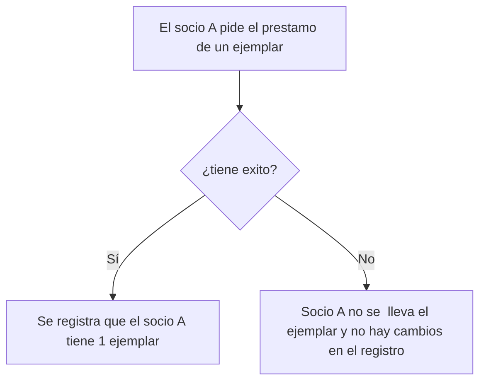

# Ejercicios — Tema 2: Ingeniería de Software

## Ejercicio 4 — Redacción de historias de usuario

Retoma el sistema de gestión de la biblioteca del Ejercicio 1.

**Tarea:**

1. Redacta al menos tres historias de usuario (formato "Como... quiero... para...") que cubran distintos roles: el socio, el bibliotecario y un administrador del sistema.
2. Para cada historia, comprueba que cumple los criterios INVEST (Independiente, Negociable, Valiosa, Estimable, Pequeña, Testeable). Si alguna no los cumple, reformúlala.
3. Elige una de las historias y escribe sus criterios de aceptación en formato Dado-Cuando-Entonces (al menos dos criterios).

### 1. Historias de usuario:

#### Historia 1 - Socio

**Como** socio de la biblioteca **quiero** buscar un libro por título o autor **para** saber si esta disponible antes de desplazarme al centro.

#### Historia 2 - Biblioteca

**Como** biblioteca **quiero** registrar el prestamo y devolucion de libros a socios **para** llevar un control de inventario disponible y saber que socio tiene cada libro.

#### Historia 3 - Administrador

**Como** administrador **quiero** consultar un listado de los libros con mas movimientos en los ultimos 30 dias **para** decidir que titulos añadir al inventario.

### 2. Comprobación de los criterios INVEST:

| Criterio        | Historia 1 (Socio)         | Historia 2 (Biblioteca) | Historia 3 (Administrador)                         |
| --------------- | -------------------------- | ----------------------- | -------------------------------------------------- |
| **I**ndependent | Sí                         | Sí                      | Sí (necesita del registro de movimiento de libros) |
| **N**egotiable  | Sí                         | Sí                      | Sí                                                 |
| **V**aluable    | Sí (evita desplazamientos) | Sí                      | Sí (apoya decisiones de compra)                    |
| **E**stimable   | Sí                         | Sí                      | Sí                                                 |
| **S**mall       | Sí                         | Sí                      | Sí                                                 |
| **T**estable    | Sí                         | Sí                      | Sí                                                 |

### 3. Criterios de aceptación de la historia 2:

#### Criterio 1:

- **Dado** que el socio A tiene exito
- **Cuando** quiere llevarse prestado un ejemplar del libro
- **Entonces** se registra que socio A tiene un ejemplar del libro y marcamos 1 ejemplar menos en el inventario

#### Criterio 2:

- **Dado** que el socio A no tiene exito
- **Cuando** quiere llevarse prestado un ejemplar del libro
- **Entonces** no se lo lleva y no hay cambios en los registros de la biblioteca ni en el inventario
